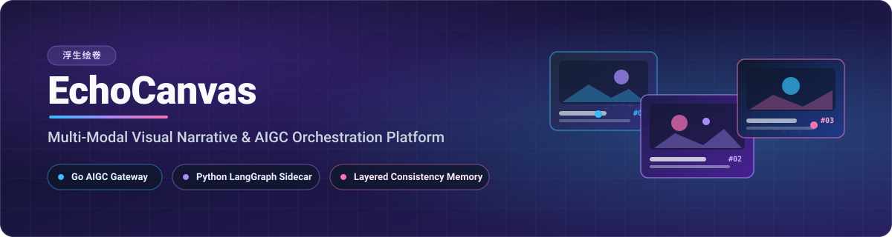
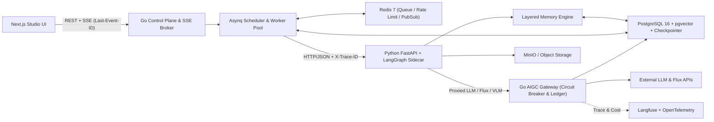

<p align="center">
  
</p>

<h1 align="center">EchoCanvas（浮生绘卷）</h1>

<p align="center">
  <strong>Controllable, Consistent, and Cost-Transparent Multi-Modal Visual Narrative &amp; AIGC Orchestration Platform</strong>
</p>

<p align="center">
  <strong>English</strong> | <a href="./README.zh-CN.md">简体中文</a>
</p>

<p align="center">
  
  
  
  
  
  
</p>

---

## Why EchoCanvas?

Text-to-image models excel at generating isolated images, yet turning a story, script, or fragmented memory into a **visually coherent multi-frame storyboard** remains brittle. EchoCanvas addresses continuity drift, black-box regeneration, and opaque multi-model costs through production-grade engineering:

| Dimension | Single-Image Generators | End-to-End AI Video Tools | EchoCanvas |
| :--- | :--- | :--- | :--- |
| **Narrative Planning** | Manual shot splitting & prompting | Implicit prompt interpretation | Structured director script breakdown (shot, camera, lighting, entity state) |
| **Cross-Frame Consistency** | Weak (manual seed & prompt tuning) | Short clip coherence; hard across cuts | **Layered Consistency Memory** + IP-Adapter visual anchoring |
| **Granular Controllability** | Isolated inpainting without story context | Full-clip re-roll on single-shot defects | **3 Human-in-the-Loop Gates** + single-frame versioning & state cascade |
| **Cost & Reliability** | Opaque credit consumption | High retry waste on partial failures | **Go AIGC Gateway**: rate limits, circuit breaking, budget guardrails, `usage_ledger` |

---

## Core Capabilities

### 1. Three Human-in-the-Loop (HITL) Control Gates
* **Gate 1 — Asset & Style Lock**: Automatically extracts characters, scenes, and global style presets from raw text. Users can edit and lock ground-truth attributes (`user_ground_truth`), preventing downstream model expansion (`agent_inferred`) from drifting away from core designs.
* **Gate 2 — Storyboard Script Review**: Reviews structured frame-by-frame shot specifications (shot size, angle, composition, lighting, dialogue) before committing visual generation credits.
* **Gate 3 — Targeted Single-Frame Regeneration**: Re-renders an unsatisfactory frame with natural-language instructions, preserves multi-version history (`frame_versions`) for side-by-side comparison, and optionally cascades entity state updates to downstream frames.

### 2. Go Control Plane & AIGC Gateway (`services/go-gateway`)
* **Async Orchestration & Scheduling**: Manages `StoryJob` and `FrameTask` lifecycles (`PENDING -> QUEUED -> RUNNING -> VERIFYING -> SUCCEEDED / FAILED`) via Redis-backed `asynq` queues, bounded Worker Pool concurrency, idempotency keys (`X-Idempotency-Key`), and exponential backoff retries.
* **Resilient Model Routing & Budget Guard**: Unified proxy for all upstream LLM, Vision, and VLM calls with token-bucket rate limiting, primary/fallback circuit breaking, Pre-flight budget ceiling enforcement (`PAUSED_BUDGET`), and per-call cost accounting in `usage_ledger`.
* **Real-Time Streaming**: Server-Sent Events (SSE) with `Last-Event-ID` replay support over Redis Pub/Sub.

### 3. Layered Consistency Memory & Quality Verification (`services/py-agent`)
* **`asset_style_profiles`**: Immutable character/scene specifications, `pgvector` embeddings, and Frame-1-anchored reference image URLs for IP-Adapter / Flux consistency.
* **`episodic_entity_states`**: Frame-indexed JSONB snapshots tracking dynamic states (posture, wet clothing, held props, weather/lighting transitions) across consecutive frames.
* **`WorkingContextBuilder`**: Context budgeting engine that enforces `user_ground_truth` precedence over `agent_inferred` details.
* **VLM Auto-Verification**: Evaluates each rendered frame for subject consistency and missing props, triggering targeted retries up to a strict cap (`<= 2` attempts).

### 4. Full-Link Observability & Automated Eval
* **End-to-End Tracing**: Unified `X-Trace-ID` propagation across Go `slog` / OpenTelemetry, Python LangGraph, and Langfuse.
* **Reproducible Eval Pipeline**: Side-by-side comparison between a stateless Baseline and EchoCanvas across a 15-story benchmark suite via VLM-as-a-Judge. Real benchmark metrics will be published in `eval/reports/latest_eval_report.md` upon completion of Milestone M3 (no fabricated placeholder metrics).

---

## System Architecture



---

## Repository Structure

```text
EchoCanvas/
├── apps/
│   └── web/                  # Next.js + TailwindCSS studio frontend
├── services/
│   ├── go-gateway/           # Go 1.23+ control plane, Asynq scheduler & AIGC proxy gateway
│   └── py-agent/             # Python 3.11+ FastAPI, LangGraph workflows, layered memory & VLM QA
├── eval/                     # Benchmark story datasets, VLM-as-a-Judge scripts & reports
├── deploy/                   # Docker Compose definitions & PostgreSQL DDL migrations
├── docs/                     # Project Charter, PRD, TDD/RFC & static visual assets
└── .workflow/                # Git-native multi-agent state, task DAG, handoffs & gate CLI
```

---

## Multi-Agent Self-Contained Workflow

EchoCanvas ships with a zero-dependency Git-native workflow engine (`.workflow/`) designed for seamless cross-machine and cross-agent collaboration (Antigravity, Claude Code, Codex, Cursor):

```bash
# 1. Inspect current project stage, active task, and latest handoff snapshot
python .workflow/scripts/workflow.py status

# 2. List unblocked atomic tasks and exact context files to load
python .workflow/scripts/workflow.py ready

# 3. Claim a task before editing code
python .workflow/scripts/workflow.py claim T-M1-01 --agent "<tool>/<model>"

# 4. Run zero-leak secret & privacy audit before committing
python .workflow/scripts/workflow.py scan-secrets

# 5. Enforce executable milestone gates
python .workflow/scripts/workflow.py verify-gate S3
```

---

## Roadmap & Milestones

* [x] **S1 — Project Charter & Architecture Alignment** ([docs/01-CHARTER.md](./docs/01-CHARTER.md))
* [x] **S2 — Product Requirements & HITL Interaction Design** ([docs/02-PRD.md](./docs/02-PRD.md))
* [x] **S3 — Technical Design, DDL & API Contracts** ([docs/03-TDD.md](./docs/03-TDD.md))
* [ ] **M1 — Go Control Plane, PostgreSQL 16 Schema & AIGC Gateway** (`T-M1-01` ~ `T-M1-04`)
* [ ] **M2 — Python LangGraph Sidecar & Layered Memory Engine** (`T-M2-01` ~ `T-M2-04`)
* [ ] **M3 — Flux + IP-Adapter Pipeline, VLM QA & Eval Benchmark** (`T-M3-01` ~ `T-M3-03`)
* [ ] **M4 — Next.js Studio UI, Deployment & Public Release Audit** (`T-M4-01` ~ `T-M4-02`)

---

## Documentation Index

| Document | Description |
| :--- | :--- |
| [docs/01-CHARTER.md](./docs/01-CHARTER.md) | Project charter, Stage-Gate lifecycle, 30-day delivery roadmap & release audit checklist |
| [docs/02-PRD.md](./docs/02-PRD.md) | Product requirements (`FR-A`~`FR-H`), HITL workflows, UI wireframes & acceptance criteria |
| [docs/03-TDD.md](./docs/03-TDD.md) | System architecture, sequence diagrams, PostgreSQL DDL, API/SSE contracts, Eval & ADR-01~04 |
| [AGENTS.md](./AGENTS.md) | Cross-agent engineering contract, context firewall & P0 security redlines |
| [.workflow/README.md](./.workflow/README.md) | Git-native workflow CLI manual and handoff protocol |

---

## Security & Privacy Policy

* **Centralized Credential Isolation**: Only the Go AIGC Gateway reads upstream provider keys from runtime environment variables; Python Sidecar and web clients never handle raw commercial API keys.
* **Pre-Commit Secret & Privacy Guard**: Automated scans via `python .workflow/scripts/workflow.py scan-secrets` block unignored `.env` files, private keys, API tokens, and local machine paths before commits and milestone gates.
