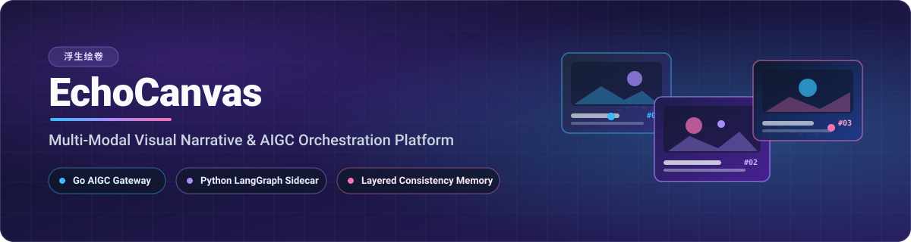
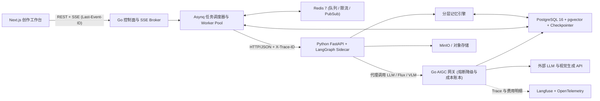

<p align="center">
  
</p>

<h1 align="center">EchoCanvas（浮生绘卷）</h1>

<p align="center">
  <strong>可控、强一致、成本透明的多模态视觉叙事与 AIGC 工程编排平台</strong>
</p>

<p align="center">
  <a href="./README.md">English</a> | <strong>简体中文</strong>
</p>

<p align="center">
  
  
  
  
  
  
</p>

---

## 为什么做 EchoCanvas？

通用文生图模型已经具备很强的单张画面表现力，但一旦用于创作**“从故事、小说或梦境片段到多帧连续分镜画卷”**的叙事表达，依然面临角色穿帮、黑盒抽卡和成本不可控等工程痛点。EchoCanvas 通过生产级前后端协同架构解决上述难题：

| 对比维度 | 通用单图工具 | 端到端 AI 视频平台 | EchoCanvas（浮生绘卷） |
| :--- | :--- | :--- | :--- |
| **叙事分镜拆解** | 人工拆分镜头并手工拼接 Prompt | 隐式黑盒解析故事文本 | 结构化导演分镜拆解（景别、机位、光影氛围、实体状态） |
| **跨帧一致性** | 弱（依赖手工反复微调 Seed 与参考图） | 单片段内连贯，跨镜头极易漂移 | **分层一致性记忆引擎** + IP-Adapter 视觉参考锚点 |
| **局部可控性** | 孤立局部重绘，缺乏剧情上下文 | 单帧瑕疵往往需要整段重抽 | **3 个人机协同卡点（HITL）** + 单帧多版本对比与状态级联 |
| **成本与稳定性** | 积分黑盒消耗 | 失败重试成本高、缺乏断点续跑 | **Go AIGC 网关**：并发限流、主备熔断、预算护栏与 `usage_ledger` 记账 |

---

## 核心能力

### 1. 三个人机协同控制卡点（Human-in-the-Loop Gates）
* **Gate 1 — 资产与风格锁定**：从文本自动抽取主角、场景与画风预设；支持人工编辑并锁定原始设定（标记为 `user_ground_truth`），防止后续模型扩写（`agent_inferred`）篡改核心特征。
* **Gate 2 — 分镜脚本审阅**：在触发昂贵视觉渲染前暂停任务，支持在线微调每一帧的景别、视角、画面构图与台词脚本。
* **Gate 3 — 单帧局部重绘与版本管理**：针对不满意的单帧输入自然语言修改指令精准重绘，保留历史版本（`frame_versions`）自由对比切换，并支持按需级联刷新下游实体状态。

### 2. Go 控制面与高可靠 AIGC 网关（`services/go-gateway`）
* **异步调度与状态管理**：基于 Redis `asynq` 调度 `StoryJob` 与 `FrameTask`（`PENDING -> QUEUED -> RUNNING -> VERIFYING -> SUCCEEDED / FAILED`），内置 Worker Pool 并发信号量、`X-Idempotency-Key` 幂等防重与指数退避重试。
* **统一模型网关与成本治理**：集中代理所有 LLM、视觉生成与 VLM 质检调用，落地令牌桶限流、主备熔断降级、Pre-flight 预算硬拦截（`PAUSED_BUDGET`）与明细落库 `usage_ledger`。
* **实时进度推流**：基于 Redis Pub/Sub 的 SSE 事件流推送，支持 `Last-Event-ID` 断线重连补偿。

### 3. 分层记忆一致性与 VLM 自动质检（`services/py-agent`）
* **`asset_style_profiles`**：持久化角色/场景结构化设定、`pgvector` 向量索引及首帧确立的参考图锚点 URL（供 IP-Adapter / Flux 锁定主体）。
* **`episodic_entity_states`**：逐帧追踪动态实体状态快照（如角色姿态、服饰干湿、手持道具、环境光影延续），防止前后穿帮。
* **`WorkingContextBuilder`**：执行上下文预算裁剪，并强制校验 `user_ground_truth` 覆盖优先权。
* **VLM 自动质检**：每帧成图后由视觉大模型校验一致性与畸形缺陷，不合格自动附带纠偏建议重试（严格上限 `<= 2` 次）。

### 4. 全链路可观测与自动化 Eval 闭环
* **跨服务链路追踪**：`X-Trace-ID` 贯通 Go `slog` / OpenTelemetry、Python LangGraph 与 Langfuse。
* **自动化对比评测（Eval）**：基于 15 组覆盖多角色与道具状态转移的基准剧本，采用 VLM-as-a-Judge 对照评测无记忆 Baseline 与 EchoCanvas；真实评测数据将在里程碑 M3 完成后发布至 `eval/reports/latest_eval_report.md`（绝不预设虚标数字）。

---

## 系统架构



---

## 仓库目录结构

```text
EchoCanvas/
├── apps/
│   └── web/                  # Next.js + TailwindCSS 创作工作台前端
├── services/
│   ├── go-gateway/           # Go 1.23+ 控制面、Asynq 异步调度与 AIGC 代理网关
│   └── py-agent/             # Python 3.11+ FastAPI、LangGraph 编排、分层记忆与 VLM 质检
├── eval/                     # 基准测试剧本集、VLM-as-a-Judge 评测脚本与报告
├── deploy/                   # Docker Compose 编排与 PostgreSQL 物理表 DDL
├── docs/                     # 项目立项书、PRD、TDD/RFC 与静态视觉资产
└── .workflow/                # Git 自包含多 Agent 状态账本、任务依赖图与门禁 CLI
```

---

## Git 自包含多 Agent 协同工作流

本仓库内置零第三方依赖的 Git-Native 工作流引擎（`.workflow/`），支持在不同电脑与多个 Coding Agent 工具（Antigravity / Claude Code / Codex / Cursor）间无缝交接续做：

```bash
# 1. 查看当前阶段、门禁状态、进行中任务与最新交接快照
python .workflow/scripts/workflow.py status

# 2. 查看前置依赖已满足的可执行原子任务与最小上下文清单
python .workflow/scripts/workflow.py ready

# 3. 认领原子任务后开始研发
python .workflow/scripts/workflow.py claim T-M1-01 --agent "<tool>/<model>"

# 4. 提交前执行密钥与隐私零泄露审计
python .workflow/scripts/workflow.py scan-secrets

# 5. 运行里程碑硬门禁检查
python .workflow/scripts/workflow.py verify-gate S3
```

---

## 研发路线图与里程碑

* [x] **S1 — 项目立项与架构定位**（[docs/01-CHARTER.md](./docs/01-CHARTER.md)）
* [x] **S2 — 完整产品需求与 HITL 交互设计（PRD）**（[docs/02-PRD.md](./docs/02-PRD.md)）
* [x] **S3 — 整体技术方案、DDL 表结构与 API 契约（TDD/RFC）**（[docs/03-TDD.md](./docs/03-TDD.md)）
* [ ] **M1 — Go 控制面、PostgreSQL 16 建库与 AIGC 网关底座**（`T-M1-01` ~ `T-M1-04`）
* [ ] **M2 — Python LangGraph Sidecar 与分层记忆引擎**（`T-M2-01` ~ `T-M2-04`）
* [ ] **M3 — Flux + IP-Adapter 视觉管线、VLM 质检与 Eval 闭环**（`T-M3-01` ~ `T-M3-03`）
* [ ] **M4 — Next.js 工作台、云端部署与公开发布安全审计**（`T-M4-01` ~ `T-M4-02`）

---

## 文档索引

| 文档 | 内容说明 |
| :--- | :--- |
| [docs/01-CHARTER.md](./docs/01-CHARTER.md) | 项目立项书、Stage-Gate 研发流程、30 天排期与公开发布审计清单 |
| [docs/02-PRD.md](./docs/02-PRD.md) | 完整产品需求（`FR-A`~`FR-H`）、3 个 HITL 流程、ASCII 线框与验收标准 |
| [docs/03-TDD.md](./docs/03-TDD.md) | 系统架构、时序图、8 张 PostgreSQL DDL、REST/SSE/内部 API 契约、Eval 与 ADR-01~04 |
| [AGENTS.md](./AGENTS.md) | 跨工具 / 跨模型工程契约、上下文防火墙与 P0 安全红线 |
| [.workflow/README.md](./.workflow/README.md) | Git 自包含工作流 CLI 手册与会话交接规范 |

---

## 安全与隐私规范

* **凭证集中隔离**：所有上游商业 API Key 仅由 Go AIGC 网关通过运行时环境变量读取，Python Sidecar 与前端均不直接持有外部密钥。
* **提交前自动化防泄露审计**：所有提交及里程碑门禁均强制通过 `python .workflow/scripts/workflow.py scan-secrets`，自动阻断未忽略的 `.env` 文件、私钥、API Token 与本机绝对路径进入版本历史。
