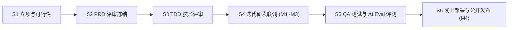

# 项目立项书与研发落地总控：EchoCanvas（浮生绘卷）

> **立项定位**：按照互联网标准 **0→1 产品研发落地流程（立项 → PRD → TDD → 迭代研发 → QA/Eval 验收 → 上线发布）**，打造一个**叙事体验完整、工程架构务实可靠、评测数据真实可验证**的多模态视觉叙事与 AIGC 工程编排开源项目。
> **核心原则**：**一切技术选型服务于真实业务痛点，绝不为了炫技强行堆砌概念；全部工程与效果指标以真实压测和 Eval 实测为准，绝不虚标数字。**

---

## 一、 项目文档总导航（0→1 全套研发产出）

| 序号 | 文档名称 | 在 0→1 流程中的角色 | 核心阅读内容 |
| :--- | :--- | :--- | :--- |
| **01** | [01-CHARTER.md](./01-CHARTER.md) | **立项书与总控路线图（本文）** | 项目价值立意、Stage-Gate 研发流程、30 天排期与需求追踪、风险矩阵与发布审计清单 |
| **02** | [02-PRD.md](./02-PRD.md) | **完整产品需求（PRD）** | 痛点与竞品分析、用户故事、3 个 HITL 卡点流程、`FR-A~FR-H` 需求清单、ASCII 线框与异常边界 |
| **03** | [03-TDD.md](./03-TDD.md) | **整体技术方案（TDD/RFC）** | Go+Python 协同架构、全链路时序图、8 张 PG16 DDL 表、REST/SSE/内部 API 契约、Eval 与 4 项 ADR |
| **WF** | [../.workflow/README.md](../.workflow/README.md) | **跨 Agent 交接工作流** | Git 自包含状态账本、任务依赖图、`AGENTS.md` 启停契约与自动化门禁校验 |

---

## 二、 立项背景与核心价值主张（Project Charter）

### 2.1 为什么不做常见的“RAG 知识库问答玩具”？
1. **差异化辨识度极低**：千篇一律的文本问答 Demo 难以验证复杂异步调度、并发治理、多模态一致性控制与全链路成本管控等真实生产工程能力。
2. **EchoCanvas 的双轮驱动价值**：
   * **产品与体验侧**：输入一段碎片梦境、小说片段（如“2016 年北京冬夜过街天桥”），通过 **3 个人机协同卡点（Gate 1 资产锁定、Gate 2 脚本审阅、Gate 3 局部重绘）**，产出角色与氛围高度一致的连续电影级分镜画卷。
   * **工程与架构侧**：采用生产级 **Go 控制面与 AIGC 网关 + Python AI 编排 Sidecar（FastAPI + LangGraph）+ PostgreSQL 16（`pgvector`）+ Redis 7** 协同架构，完整落地异步调度、分层记忆一致性引擎、成本熔断以及 VLM-as-a-Judge 自动化评测闭环。

---

## 三、 0→1 标准研发落地流程（Stage-Gate）

本项目严格遵循标准研发推进规范，明确每个阶段的产出物与准出卡点（Gate）：

| 阶段 | 核心产出与目标 | 准出卡点（Exit Gate） | 当前状态 |
| :--- | :--- | :--- | :--- |
| **S1 立项与可行性** | 确定产品定位、Go+Python 架构方向、30 天范围边界（MVP vs Stretch） | 确认技术方案无炫技冗余且成本可控 | **已完成** |
| **S2 PRD 评审冻结** | 完成 `02-PRD.md` 文档，冻结 `FR-A~FR-G` 的 P0 需求清单与 3 个 HITL 交互规则 | 所有 P0 需求边界、异常场景与验收标准无歧义 | **已完成** |
| **S3 TDD 技术评审** | 完成 `03-TDD.md` 文档，冻结 8 张 DDL 表结构、REST/SSE/内部 API 契约与 4 项 ADR | 接口契约、预算熔断策略与 Checkpointer 方案可指导编码 | **已完成** |
| **S4 迭代研发联调** | 按 M1（Go 底座）→ M2（Python Sidecar）→ M3（视觉管线与质检）推进编码与联调 | Mock 集成测试全绿 + 真实端到端主链路跑通 | **当前阶段（待启动 M1）** |
| **S5 QA 与 AI Eval** | 执行 Go/Python 单元测试、15 组剧本 Baseline vs EchoCanvas 对比 Eval | 生成真实 `latest_eval_report.md` 与成本基准数据 | 待执行 |
| **S6 线上部署与公开发布** | Docker Compose 云端部署、开源级 README、Showcase 录制与公开发布安全审计 | 可访问线上 Demo + 真实 Eval 报告 + 密钥隐私审计全绿 | 待执行 |

---

## 四、 30 天里程碑研发排期与需求映射

### M1（Week 1 / Day 1 - Day 7）：控制面与 AIGC 网关底座
* **关联需求与模块**：`FR-A01/04`、`FR-D04`、`FR-F01/02/03` ｜ 对应 `03-TDD.md` 第 3、4、5.1 节。
* **核心交付物**：
  1. 初始化基础设施 `deploy/docker-compose.yml`（PostgreSQL 16 + `pgvector` + Redis 7 + MinIO），导入 8 张物理表 DDL。
  2. 完成 Go 控制面（Gin + `pgx` + `asynq`）：实现项目 CRUD、`StoryJob`/`FrameTask` 调度、幂等键拦截、并发信号量与指数退避重试。
  3. 实现 Go AIGC 网关代理（`usage_ledger` 落库、令牌桶限流、Pre-flight 预算检查、主备模型熔断切换）、`X-Trace-ID` 透传与 SSE Broker（先用 Mock Sidecar 验证事件流）。
* **M1 验收标准（DoD）**：`go test` 核心单元测试通过；提交 Mock 任务后 SSE 实时推流正常，重复提交被幂等拦截，超预算触发 `PAUSED_BUDGET`。

### M2（Week 2 / Day 8 - Day 14）：Python Sidecar + LangGraph 编排 + 分层记忆
* **关联需求与模块**：`FR-B01~04`、`FR-C01/02/04`、`FR-E01/02` ｜ 对应 `03-TDD.md` 第 5.2、5.3 节。
* **核心交付物**：
  1. 搭建 FastAPI Sidecar 与 `langgraph-checkpoint-postgres`，打通 `extract_assets`（停在 Gate 1）与 `plan_script`（停在 Gate 2）及 `/internal/v1/workflows/resume`。
  2. 实现分层记忆服务：`asset_style_profiles`（支持 `user_ground_truth` 锁定）、`episodic_entity_states`（逐帧快照）及 `WorkingContextBuilder`（裁剪与优先级覆写）。
  3. 打通 Go 控制面 ↔ Python Sidecar 联调（生图阶段先返回占位图），验证杀掉 Sidecar 后断点恢复及 Gate 3 单帧局部重绘状态流转。
* **M2 验收标准（DoD）**：`pytest` 记忆覆写与解析测试通过；端到端走通 `新建 -> Gate 1 锁定 -> Gate 2 编辑剧本 -> 断点恢复 -> 单帧重绘` 全状态链路。

### M3（Week 3 / Day 15 - Day 21）：视觉渲染管线、VLM 质检与 Eval 评测闭环
* **关联需求与模块**：`FR-D01~03`、`FR-F03`、`FR-H02` ｜ 对应 `03-TDD.md` 第 6、7 节。
* **核心交付物**：
  1. 接入云端 Flux + IP-Adapter API（统一走 Go 网关代理并上传对象存储），实现 Frame 1 锚定、Frame 2..N 并发带参考图渲染。
  2. 实现 `vlm_quality_check` 自动质检节点（不合格纠偏重绘上限 `<= 2` 次）及全链路 Langfuse Tracing 对接。
  3. 完成 10~15 组基准测试剧本（含“2016 北京冬夜天桥”）的 Baseline vs EchoCanvas 对比 Eval 评测并输出真实评测报告。
* **M3 验收标准（DoD）**：产出可复现的 Eval 对比报告与真实 Token/延迟/一致率统计；主供应商异常切换备选模型验证通过。

### M4（Week 4 / Day 22 - Day 30）：前端工作台、云端部署与开源发布准备
* **关联需求与模块**：`FR-A03`、`FR-G01~03`、选做 `FR-H01` ｜ 对应 `02-PRD.md` 第 5 节与 `03-TDD.md` 第 6.3 节。
* **核心交付物**：
  1. 构建 Next.js 三栏创作工作台（内置模板、SSE 流水线、分镜画廊、版本对比抽屉、账单详情与长图导出；时间充裕补上 `FR-H01` Canvas 草图 ControlNet 入口）。
  2. 完成云服务器 Docker Compose 部署，生成 3 组高质量 Showcase 与演示 GIF，撰写完整 `README.md`（含架构图与实测 Eval 数据）。
  3. 完成全仓密钥与隐私安全审计（`workflow.py scan-secrets` 与 Git 历史核查），确认无误后将仓库切换为公开开源。
* **M4 验收标准（DoD）**：所有 `AC-01 ~ AC-06` 验收通过，拥有可点击访问的线上 Demo 与安全审计全绿的公开 GitHub 仓库。

---

## 五、 项目风险与应对矩阵

| 风险项 | 影响等级 | 应对与止损措施 |
| :--- | :--- | :--- |
| **Go 与 Python 双服务首轮集成复杂度风险** | 中 | 控制 Go 层代码规模在清晰标准的 `Gin + pgx + asynq` 范式内，避免过度抽象或引入 gRPC，通过 OpenAPI/JSON Schema 严格对齐跨进程契约。 |
| **外部生图与 VLM API 费用超支** | 高 | 开发调试期全程用 Mock Adapter 跑通逻辑；真实联调阶段严格依赖 Go 网关 `budget_limit_usd` 硬拦截与单帧 `<= 2` 次重试上限。 |
| **多镜头视觉一致性不稳定** | 中 | 在 Frame 1 确立独立主角参考图并通过 IP-Adapter 权重调优，同时配合 `episodic_entity_states` 结构化约束动作/道具描述；如实记录在 Eval 报告中的改进与局限。 |
| **30 天范围蔓延导致延期** | 高 | 严守 `02-PRD.md` 中 P0（MVP 必做）与 P1/P2（Stretch）红线；Canvas 草图、分支剧情树与 MCP Server 坚决留在 MVP 主闭环彻底跑通之后再扩展。 |

---

## 六、 发布前验收清单与公开安全审计规范

在将仓库从 Private 切换为 Public 开源前，必须逐项完成以下全部核验：

### 6.1 功能与工程验收清单（对应 `02-PRD.md` AC-01 ~ AC-06）
* [ ] **主链路闭环**：文本输入 -> Gate 1 资产锁定 -> Gate 2 脚本修改 -> 异步多帧渲染 -> Gate 3 局部重绘 -> 导出长图全流程跑通。
* [ ] **容错与断点恢复**：幂等键防重生效；模拟中断 Python Sidecar 重启后可从 LangGraph Checkpoint 无损续跑；模拟主模型异常自动熔断降级。
* [ ] **全链路账单与 Trace**：前端展示金额与 `usage_ledger` 完全一致，可通过 `Trace ID` 在 Langfuse 查看完整调用链。

### 6.2 Eval 评测与文档真实性清单
* [ ] 已运行 `eval/` 下不少于 10 组基准剧本对比实验，生成 `eval/reports/latest_eval_report.md`。
* [ ] `README.md` 中引用的角色一致率、Token 开销变化、P95 延迟全部来自 Eval 真实报告输出，无任何主观估算数字。

### 6.3 开源公开前密钥与隐私安全审计清单
* [ ] 运行 `python .workflow/scripts/workflow.py scan-secrets` 与 `verify-gate M4` 全部返回 `[GATE PASS]`。
* [ ] 确认 `.env`、真实 API Key、数据库密码、个人邮箱/姓名、内网域名或本机绝对路径未出现在任何代码、配置文件、`.workflow/handoffs/` 及全部 Git Commit 历史中。
