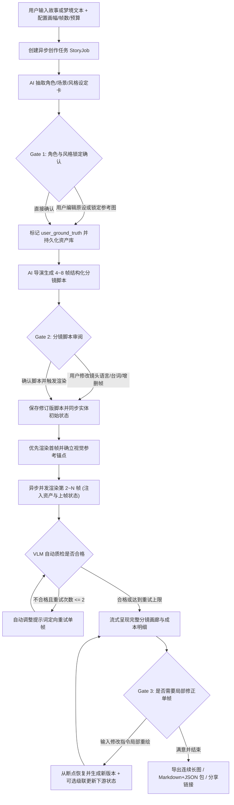

# EchoCanvas（浮生绘卷）—— 完整产品需求与交互设计文档（PRD）

## 文档元信息与版本控制

| 属性 | 内容 |
| :--- | :--- |
| **产品名称** | EchoCanvas（浮生绘卷）—— 多模态视觉叙事与 AIGC 创作工作台 |
| **文档版本** | v1.0（大厂 0→1 评审级 PRD） |
| **创建日期** | 2026-11-25 |
| **文档作者** | EchoCanvas 核心研发团队 |
| **关联立项书** | [01-CHARTER.md](./01-CHARTER.md) |
| **关联技术方案** | [03-TDD.md](./03-TDD.md) |
| **MVP 发布目标** | 4 周内完成可在线访问的端到端视觉叙事闭环（含可观测与 Eval 评测基线） |
| **需求优先级定义** | **P0**：MVP 核心闭环必做；**P1**：首轮迭代增强；**P2**：远期生态扩展 |

---

## 一、 业务背景、核心痛点与竞品分析

### 1.1 业务背景与核心痛点
当前通用文生图（Text-to-Image）模型已具备极高的单帧美学渲染能力，但一旦创作者尝试用 AI 完成**“从故事、小说或梦境片段到多帧连续分镜画卷”**的叙事表达，仍然面临四大结构性痛点：

1. **单图抽卡强，连续叙事弱**：用户需要手工拆分镜头、反复拼接 Prompt，缺少懂分镜语言（景别、机位、情绪光影衔接）的导演级自动化拆解能力。
2. **跨帧角色与场景穿帮（一致性漂移）**：第 1 帧穿黑风衣的主角到第 3 帧突然变脸或换衣，第 2 帧手里撑的伞到第 4 帧凭空消失，长上下文下模型极易忘记早期设定。
3. **盲盒式生成，缺乏可控的局部修正**：传统工具一旦整套结果中有 1 帧崩坏或构图不合预期，往往只能整组重跑或另开对话盲抽，既浪费算力又破坏前序已满意的画面。
4. **多模型调用成本与稳定性黑盒**：连续多帧生成涉及 LLM 推理、参考图生图、VLM 质检等多轮调用，缺乏透明的单任务费用明细、并发限流与部分失败后的断点恢复机制。

### 1.2 竞品对标与差异化定位

| 维度 | 通用单图工具（Midjourney / Flux Web） | AI 视频平台（即梦 / 可灵） | 传统分镜软件（Storyboarder） | EchoCanvas（本产品） |
| :--- | :--- | :--- | :--- | :--- |
| **核心能力** | 单帧高质量抽卡 | 直接生成短视频片段 | 人工手绘/摆拍分镜 | 叙事自动拆解 + 一致性多帧分镜 |
| **角色/道具连贯性** | 弱（依赖人工反复微调 Seed/Ref） | 中（视频短片内连贯，跨镜头难控） | 强（纯人工维护） | 强（资产锚点 + 逐帧实体状态追踪） |
| **局部可控性** | 仅支持单图局部重绘，无上下帧关联 | 整段重抽，单帧精细修改成本高 | 强（全人工） | 强（3 个 HITL 卡点 + 单帧版本对比与状态级联） |
| **成本透明度与治理** | 订阅积分黑盒 | 积分消耗高、失败成本难控 | 无 AI 算力成本 | 精确到每次 LLM/生图调用的费用账单与预算熔断 |
| **产品差异化定位** | 灵感单图生成器 | 短视频生成引擎 | 专业线下绘图工具 | **可控、可编辑、强一致性、成本透明的多模态叙事工作台** |

---

## 二、 目标用户画像与核心用户故事

### 2.1 目标用户画像（Personas）

1. **P1 核心用户：视觉叙事与梦境/小说记录者（个人创作者）**
   * **特征**：拥有丰富的画面想象力与情绪表达欲（如记录深刻的梦境、撰写短篇小说/随笔），但缺乏多年专业绘画功底，无法将脑海中的连续画面与氛围准确落到纸面。
   * **核心诉求**：输入文字描述（或极粗糙草图），在可控预算内快速获得人物与氛围连贯的高清分镜画卷，并能对不满意的单帧精确微调。
2. **P2 延伸用户：AIGC 动态漫 / 独立叙事游戏策划**
   * **特征**：需要高频产出前期分镜脚本与概念气氛图（Moodboard），验证剧情节奏与角色定妆，对角色跨镜头一致性、导出脚本包与二次编辑效率要求高。
   * **核心诉求**：可锁定主角设定与画风卡，快速批量生成分镜并在脚本层/成图槽位上反复打磨，导出结构化分镜资产。
3. **P3 平台用户：AI 应用研发与评测工程师**
   * **特征**：关注系统工程化程度、状态可追踪性、成本治理与效果评估闭环，而非仅看表面 UI。
   * **核心诉求**：直观看到后端异步任务流转、断点恢复能力、实时 Token/生图开销明细，以及量化证明“分层记忆机制有效”的 Eval 评估数据。

### 2.2 核心用户故事（User Stories）

* **US-01**：作为**个人创作者**，我希望输入一段碎片化的梦境或小说文字并选择画幅与风格，以便 AI 自动帮我规划出具有电影镜头感的分镜脚本。
* **US-02**：作为**个人创作者**，我希望在批量生图前能先核对并锁定主角外貌和场景基调，以便模型后续扩写不会篡改我最在意的原始设定。
* **US-03**：作为**分镜策划**，我希望在花钱生图前能预览和修改每帧的景别、动作与台词脚本，以便避免方向偏差导致整组算力浪费。
* **US-04**：作为**分镜策划**，我希望成图阶段能实时看到每帧的生成与质检进度，即使其中 1 帧超时失败，已完成的帧也能安全保留并支持单独重试。
* **US-05**：作为**创作者**，我希望针对第 N 帧不满意的画面输入局部修改意见重新生成，并自由对比切换历史版本，同时让后续分镜按需同步最新状态。
* **US-06**：作为**精打细算的用户**，我希望设置单次创作预算上限并查看每次调用的 Token 与生图费用明细，以便完全掌控花费。
* **US-07**：作为**AI 研发与评测工程师**，我希望在平台上看到完整的执行 Trace 链路与 Baseline vs 分层记忆的自动化 Eval 评测对比，以便验证系统工程可靠性与算法真实收益。

---

## 三、 产品信息架构与端到端业务流程

### 3.1 产品信息架构（IA）

```text
EchoCanvas Web 应用
├── /projects                        项目中心（项目列表、内置“2016北京冬夜”体验模板、新建项目入口）
├── /projects/:id/studio             核心创作工作台（三栏联动：资产锁定 + 分镜时间轴画廊 + 单帧详情/重绘/成本抽屉）
│   ├── Stage 1: 叙事输入与参数配置
│   ├── Stage 2: Gate 1 资产与风格锁定面板
│   ├── Stage 3: Gate 2 分镜脚本编辑器
│   └── Stage 4: 成图画廊 + Gate 3 单帧局部重绘与版本对比
├── /projects/:id/assets             项目资产与设定库（角色设定卡、参考图锚点、逐帧实体状态历史）
└── /analytics                       成本账单、链路追踪与 Eval 对比评测看板
```

### 3.2 端到端业务流程（含 3 个人机协同卡点 HITL Gates）



---

## 四、 完整功能需求清单（FR-A ~ FR-H）

### 4.1 FR-A：项目管理与创作输入配置

| 需求编号 | 需求点 | 详细业务规则与交互要求 | 优先级 |
| :--- | :--- | :--- | :--- |
| **FR-A01** | 项目 CRUD | 支持新建、查看列表、重命名、删除项目；项目列表展示封面缩略图、当前阶段状态、已产生总费用。 | P0 |
| **FR-A02** | 叙事文本与参数配置 | 支持输入 100~5000 字故事或梦境片段；支持选择画幅（`16:9`、`9:16`、`1:1`）、目标分镜数（4~8 帧，默认 4 帧）与基础画风 Preset（如电影写实、新海诚冷峻唯美、水彩绘本）。 | P0 |
| **FR-A03** | 内置体验模板 | 提供“2016 北京冬夜过街天桥”等 2~3 套精选示范剧本，支持新用户 1 秒一键填充体验全流程。 | P0 |
| **FR-A04** | 单任务预算上限 | 允许配置单次任务预算阈值（默认 `$0.50` USD）；达到阈值前发出预警，触发上限自动暂停等待用户授权追加。 | P0 |

### 4.2 FR-B：角色与世界观资产库

| 需求编号 | 需求点 | 详细业务规则与交互要求 | 优先级 |
| :--- | :--- | :--- | :--- |
| **FR-B01** | 自动实体与风格抽取 | 提交故事后，自动抽取主角列表（外貌、年龄、核心服饰）、关键场景与全局氛围基调，生成结构化资产卡片。 | P0 |
| **FR-B02** | 原设锁定与来源优先级 | 用户可在 Gate 1 修改任意角色/场景设定并点击锁定，系统将其标记为 `user_ground_truth`；AI 后续扩写标记为 `agent_inferred`，冲突时强制以用户原设为准。 | P0 |
| **FR-B03** | 参考图锚点绑定 | 支持优先生成角色定妆照（或由首帧确立、用户手动上传参考图），绑定为该角色的视觉锚点 URL，用于后续帧锁定面部与画风。 | P0 |
| **FR-B04** | 长篇设定向量检索 | 将资产与世界观设定向量化入库，在多帧拆解与局部重绘时按需检索 Top-K 相关设定，避免无关信息污染上下文。 | P0 |

### 4.3 FR-C：AI 导演分镜拆解与脚本编辑

| 需求编号 | 需求点 | 详细业务规则与交互要求 | 优先级 |
| :--- | :--- | :--- | :--- |
| **FR-C01** | 结构化分镜拆解 | 输出严格符合 Schema 的分镜列表，每帧包含：镜头序号、景别（特写/中景/远景）、机位视角、画面构图描述、光影与情绪氛围、角色动作、旁白/台词、以及本帧结束时的实体状态快照。 | P0 |
| **FR-C02** | Gate 2 人工审阅编辑 | 在触发视觉渲染前暂停任务，用户可在线修改任意分镜的构图描述、景别或台词，保存后立即更新实体上下文基线。 | P0 |
| **FR-C03** | 分镜增删与重排 | 支持在 Gate 2 阶段插入新分镜、删除冗余分镜或调整分镜顺序（总数限制在 2~10 帧内）。 | P1 |
| **FR-C04** | 单帧实体状态追踪视图 | 在分镜卡片侧边展示本帧继承自上一帧的动态状态（如“风衣已打湿”、“左手拎黑色公文包”），让用户直观理解一致性约束来源。 | P0 |

### 4.4 FR-D：一致性视觉渲染与自动质检

| 需求编号 | 需求点 | 详细业务规则与交互要求 | 优先级 |
| :--- | :--- | :--- | :--- |
| **FR-D01** | 首帧先行的分步渲染 | 第 1 帧优先生成并确认核心主体视觉锚点后，第 2~N 帧再并发异步提交渲染，确保参考图特征稳定注入。 | P0 |
| **FR-D02** | 上下文预算裁剪装配 | 渲染每帧时仅装配“全局资产卡 + 上一帧关联实体状态 + 本帧镜头语言”，控制单次 Prompt 紧凑高效，避免长上下文注意涣散。 | P0 |
| **FR-D03** | VLM 自动质检与定向重试 | 每帧成图后由视觉大模型校验“主体是否存在、服装/道具是否穿帮、有无严重畸形”；不达标则自动附带纠偏提示重试，单帧自动重试上限严格限制为 **2 次**。 | P0 |
| **FR-D04** | 多供应商容错降级 | 当主 LLM 或主生图接口超时/触发限流时，自动平滑切换至备选模型供应商，并对部分失败任务支持单帧断点续跑。 | P0 |

### 4.5 FR-E：单帧局部重绘与版本管理

| 需求编号 | 需求点 | 详细业务规则与交互要求 | 优先级 |
| :--- | :--- | :--- | :--- |
| **FR-E01** | 单帧自然语言微调重绘 | 在画廊中点击任意帧输入局部修改指令（如“把风衣领口立起来，背景行人虚化”），仅重新调度该帧渲染，不重新生成其余帧。 | P0 |
| **FR-E02** | 多版本历史留存与切换 | 每次重绘生成新的 `frame_version` 记录（含对应 Seed、Prompt 快照、VLM 评分），用户可左右对比多个历史版本并随时切换当前激活版本。 | P0 |
| **FR-E03** | 下游实体状态级联提示 | 当某帧局部重绘显著改变了实体状态（如角色拿起了新道具），提示用户选择“仅替换本帧”或“同步刷新受影响的下游帧状态”。 | P1 |
| **FR-E04** | 固定 Seed 复现微调 | 支持基于当前帧 Seed 做小幅扰动重绘，保留整体构图仅修正局部细节。 | P1 |

### 4.6 FR-F：实时进度、成本账单与可观测视图

| 需求编号 | 需求点 | 详细业务规则与交互要求 | 优先级 |
| :--- | :--- | :--- | :--- |
| **FR-F01** | SSE 流式分阶段进度 | 前端实时展示任务阶段（资产抽取 -> Gate 等待 -> 脚本拆解 -> 分帧渲染 -> VLM 质检），每帧呈现独立骨架屏与状态徽标。 | P0 |
| **FR-F02** | 精细化费用账单明细 | 展示本次创作及每帧消耗的 Input/Output Tokens、生图张数、调用模型名称与折算美元/人民币费用，支持按模型分类汇总。 | P0 |
| **FR-F03** | 全链路 Trace ID 透传 | 任务详情页暴露 `Trace ID` 与各节点耗时分布（调度排队耗时、LLM 耗时、生图耗时、质检耗时），支持直接跳转或关联 Langfuse 查看原始 Span。 | P0 |

### 4.7 FR-G：导出与展示分享

| 需求编号 | 需求点 | 详细业务规则与交互要求 | 优先级 |
| :--- | :--- | :--- | :--- |
| **FR-G01** | 连续分镜长图拼接导出 | 一键将当前所有激活帧（可选附带台词字幕条与页边距）拼接导出为高清 PNG 长图或压缩包。 | P0 |
| **FR-G02** | 结构化剧本分镜包导出 | 导出包含资产设定、每帧脚本 JSON/Markdown 及图片相对引用的完整 ZIP 文档包，便于导入剪辑或二次开发。 | P1 |
| **FR-G03** | 只读作品演示链接 | 生成免登录只读展示页链接，方便创作者向协作者、团队或开源社区分享分镜画卷与生成成本/耗时概览。 | P1 |

### 4.8 FR-H：迭代扩展能力（P1/P2）

| 需求编号 | 需求点 | 详细业务规则与交互要求 | 优先级 |
| :--- | :--- | :--- | :--- |
| **FR-H01** | Canvas 构图草图控制 | 在工作台内嵌轻量画板，用户可手绘线条草图，通过 ControlNet（Scribble/Canny）约束对应分镜的画面构图。 | P1 |
| **FR-H02** | 自动化 Eval 对比评测台 | 内置基准测试集运行入口，同屏对比“无记忆裸生图 Baseline”与“EchoCanvas 分层记忆”的成图序列及 VLM 裁判得分。 | P1 |
| **FR-H03** | 多分支互动剧情树 | 允许在任意分镜节点分叉，衍生不同结局分支并可视化管理树状剧情流。 | P2 |
| **FR-H04** | MCP 工具协议暴露 | 将资产查询、连续性校验、单帧渲染能力封装为标准 MCP Server，供外部 AI 客户端或 IDE 直接调用。 | P2 |

---

## 五、 核心页面结构设计（ASCII 线框与交互规范）

### 5.1 核心创作工作台（`/projects/:id/studio`）布局线框

```text
+---------------------------------------------------------------------------------------------------+
| EchoCanvas [项目: 2016北京冬夜天桥]   状态: ● 渲染中 (3/4帧完成)   费用: $0.14 / $0.50   [导出] [Trace] |
+-----------------------+-----------------------------------------------+---------------------------+
| 【左栏: 资产与基调】    | 【中栏: 连续分镜时间轴画廊】                    | 【右栏: 选中帧详情与控制】   |
|                       |                                               |                           |
| [风格预设]             |  +-------------------+   +-----------------+  | 正在查看: 第 3 帧 (版本v2)  |
|  冷峻电影唯美 [锁定]    |  | Frame 01 [已锁锚点] |   | Frame 02 [已通过] |  |                           |
|                       |  | [高清成图]         |   | [高清成图]      |  | [景别/视角] 中景仰拍       |
| [核心角色]             |  | VLM评分: 9.2      |   | VLM评分: 8.8    |  | [画面描述] 主角走上湿滑天桥 |
|  > 林深 (男/黑风衣)    |  | "深紫夜空下..."   |   | "霓虹照亮水洼..." |  | 台阶，风衣下摆被雪打湿...  |
|    [参考图缩略图]       |  +-------------------+   +-----------------+  |                           |
|    标签: 用户原设锁定   |                                               | [继承上帧实体状态]         |
|    [编辑原设]          |  +-------------------+   +-----------------+  | - 林深: 黑风衣(微湿),无伞  |
|                       |  | Frame 03 [当前选中] |   | Frame 04 [质检中] |  | - 天气: 细雪, 深紫夜空     |
| [核心场景]             |  | [高清成图 v2]     |   | [骨架屏动画]     |  |                           |
|  > 过街天桥 (2016北京) |  | VLM评分: 8.5      |   | 状态: VERIFYING  |  | [局部重绘指令 (Gate 3)]    |
|    标签: 用户原设锁定   |  +-------------------+   +-----------------+  | ┌───────────────────────┐ |
|                       |                                               | │ 输入修改意见，如拉近特写 │ |
| [实时执行流水线]       |  +-------------------------------------------+  | └───────────────────────┘ |
|  ✓ 1.资产抽取 (1.8s)  |  | 底部版本对比条 (Frame 03):                |  | [仅重绘本帧] [重绘并刷新下游] |
|  ✓ 2.分镜拆解 (3.4s)  |  | [v1 (评分7.1)]  [v2 ★当前激活 (评分8.5)]  |  |                           |
|  ● 3.渲染质检 (进行中) |  +-------------------------------------------+  | [本帧费用] $0.04 (Flux+VLM)|
+-----------------------+-----------------------------------------------+---------------------------+
```

### 5.2 五大关键交互状态规范

1. **空状态（Empty State）**：首次创建项目时，工作台中央提供“输入灵感文本”主输入框及 3 枚“一键填入精选记忆/小说示例”胶囊按钮，消除新用户面对空白页面的无措感。
2. **Gate 暂停待确认态（Waiting Gate）**：当流程停留在 `Gate 1`（资产核对）或 `Gate 2`（分镜脚本审阅）时，顶部状态栏亮起琥珀色呼吸灯提示“等待您的确认后继续”，主操作区高亮“锁定并继续下一步”按钮，防止在用户未审阅前盲目发起生图扣费。
3. **SSE 流式执行态（Streaming）**：已完成的帧立即呈现高清图与 VLM 分数，正在渲染中的帧显示对应子阶段文案（`队列排队中` -> `生成图像中` -> `VLM 质检中`），左侧流水线进度同步更新耗时。
4. **单帧局部失败态（Partial Failure）**：当 4 帧中有 1 帧因上游超时或质检未达标失败时，**其余 3 帧正常展示且状态不受影响**；失败帧卡片展示明确可读的错误原因（如“上游生图超时”或“人物服装偏离原设”）与一键“单独重试该帧”按钮。
5. **预算预警/熔断态（Budget Guardrail）**：单任务已消耗费用达到预算上限 80% 时顶部显示黄色提示；达到 100% 时优雅暂停后续未开始的渲染子任务，弹出“预算已达上限，点击追加预算继续或保留当前已成图”确认框。

---

## 六、 异常场景、业务边界与风控规则

| 场景类别 | 触发条件 | 系统处理与用户反馈规则 |
| :--- | :--- | :--- |
| **内容安全审核拦截** | 用户输入或大模型改写后的 Prompt 触发上游安全过滤（NSFW/敏感词） | 立即拦截并标记 `SAFETY_BLOCKED`，提示用户具体哪一帧文本触发风控以便修改，**不触发无效重绘重试**，避免白白消耗多次失败扣费。 |
| **表单重复提交** | 用户网络抖动连续两次点击“开始生成” | 前端按钮置灰防抖 + 后端基于 `idempotency_key` 做幂等拦截，直接返回已创建的同一 `job_id` 并复用 SSE 流。 |
| **浏览器刷新或断线** | 生成过程中用户刷新页面或网络闪断 | SSE 携带 `Last-Event-ID` 自动重连补发事件；后端所有作业状态与 LangGraph Checkpoint 均已持久化至 PostgreSQL，刷新后无损还原最新进度。 |
| **模型供应商故障** | 主 LLM 或主 Flux 接口连续超时或返回 5xx | Go 网关熔断器触发，自动切换至已配置的备选模型供应商并在流水线日志中透明记录降级事件。 |
| **局部重绘死循环防控** | 某帧连续 2 次 VLM 质检仍未达标 | 自动停止自动重试，保留最佳得分版本并将状态置为“待人工确认”，交由用户查看反馈后决定采用或手工微调 Prompt。 |

---

## 七、 数据埋点与产品验收标准

### 7.1 核心产品埋点事件

| 事件名 | 触发时机 | 关键采集属性 | 分析用途 |
| :--- | :--- | :--- | :--- |
| `story_job_created` | 用户点击创建并触发剧本拆解 | `project_id`, `template_used`, `aspect_ratio`, `target_frames` | 评估模板吸引力与任务规模分布 |
| `gate_confirmed` | 用户通过 Gate 1 或 Gate 2 | `gate_no`, `edited_fields_count`, `stay_seconds` | 衡量 AI 首轮拆解准确度与人机修正比例 |
| `frame_rendered` | 单帧渲染+质检结束 | `frame_index`, `auto_retry_count`, `vlm_score`, `cost_usd`, `duration_ms` | 监控一次通过率、单帧成本与 P95 延迟 |
| `frame_regenerated` | 用户主动发起 Gate 3 单帧局部重绘 | `frame_index`, `cascade_downstream`, `version_no` | 评估用户满意度与局部重绘高频诉求 |
| `artifact_exported` | 用户导出长图或剧本包 | `export_format`, `frame_count`, `total_job_cost_usd` | 衡量端到端创作完成率 |

### 7.2 MVP（P0）上线验收标准（Acceptance Criteria）

* **AC-01（闭环完整性）**：从输入故事文本到导出连续分镜长图，全流程无报错跑通；Gate 1、Gate 2 均可正确暂停、编辑、锁定 `user_ground_truth` 并恢复执行。
* **AC-02（断点与幂等）**：重复提交同一请求不产生双份账单；任务运行中模拟杀掉 Python Sidecar 进程重启后，能从 LangGraph Checkpoint 恢复未完成帧继续执行。
* **AC-03（局部重绘与版本）**：对第 3 帧发起局部重绘后，第 1、2、4 帧图像与耗时无变化，第 3 帧成功生成 `v2` 并支持在 `v1`/`v2` 间秒级切换。
* **AC-04（网关降级与限流）**：模拟主模型返回 503，Go 网关能在 1 次失败后自动切换备选通道完成请求；单任务达到设定预算上限时准确拦截后续消费。
* **AC-05（成本与 Trace 透明）**：前端展示的账单总金额与后端 `usage_ledger` 明细汇总完全一致，通过 `Trace ID` 可在 Langfuse 中完整查到对应跨服务调用链。
* **AC-06（自动化 Eval 验收）**：完成不少于 10 组测试剧本的 Baseline vs EchoCanvas 对比评测并输出真实数据报告（具体一致性提升幅度与 Token 消耗数据以第 3 周实测为准，禁止预设虚标数字）。
