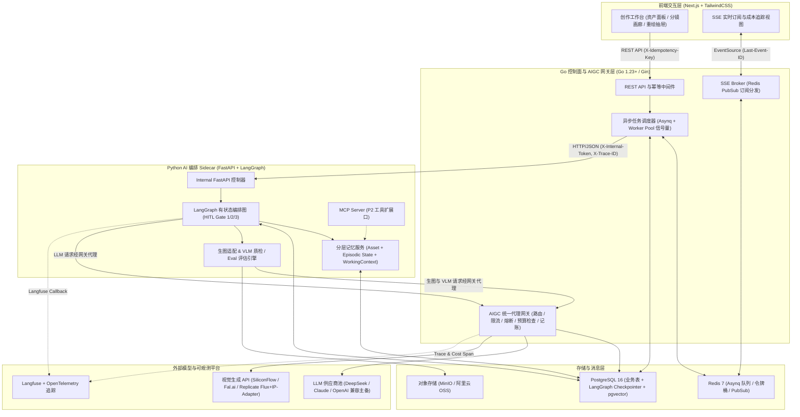
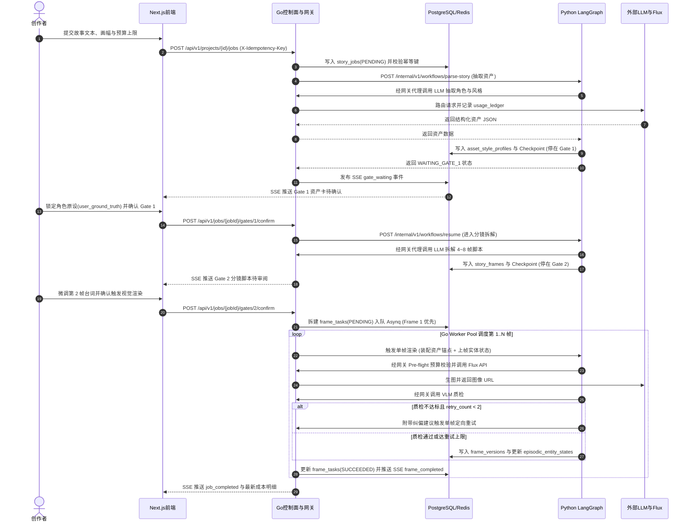
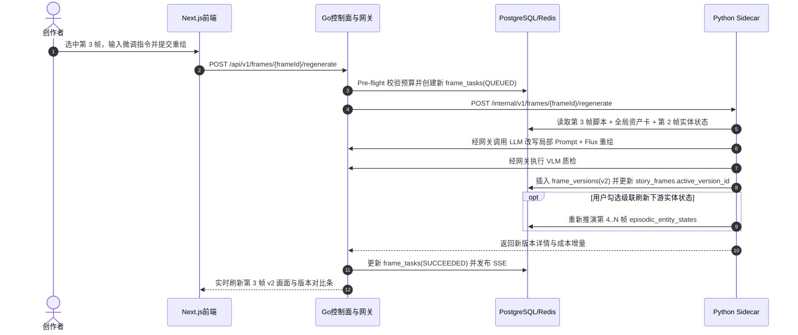
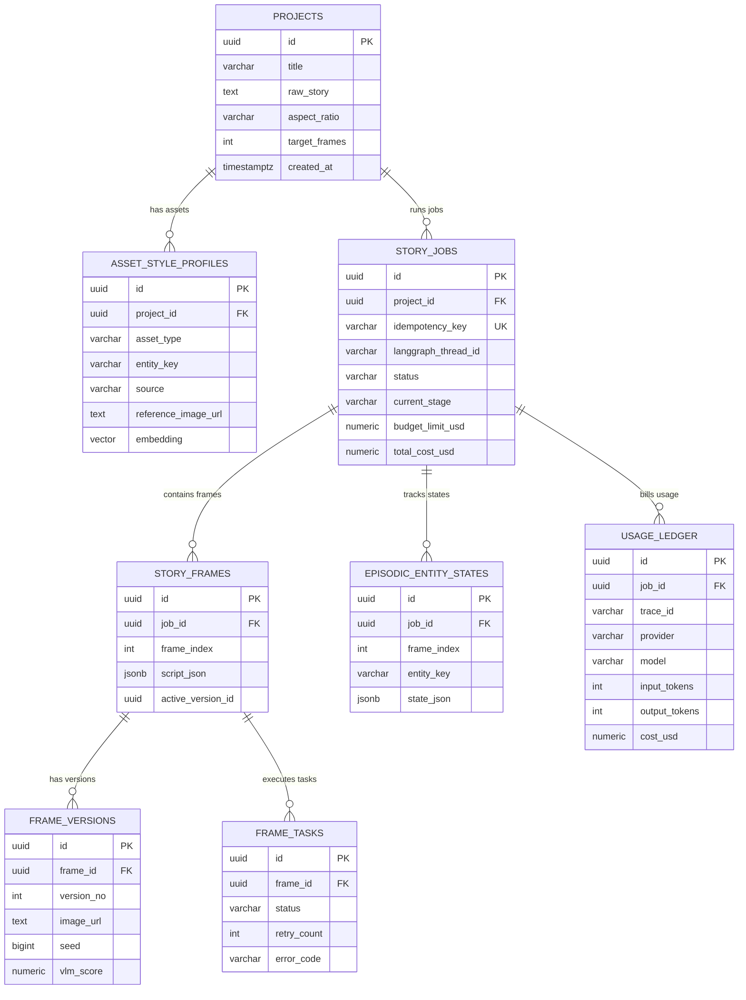

# EchoCanvas（浮生绘卷）—— 整体技术设计方案（TDD / RFC）

## 文档元信息与架构设计目标

| 属性 | 内容 |
| :--- | :--- |
| **系统名称** | EchoCanvas（浮生绘卷）多模态视觉叙事与 AIGC 工程编排平台 |
| **文档版本** | v1.0（技术评审级 TDD / RFC） |
| **对应产品需求** | [02-PRD.md](./02-PRD.md) |
| **关联立项排期** | [01-CHARTER.md](./01-CHARTER.md) |
| **目标读者** | 后端架构研发、AI 应用工程师、前端工程师、平台运维与评测人员 |

### 非功能性设计目标（NFRs）
1. **可靠性与断点恢复**：任务状态与工作流快照全量持久化至 PostgreSQL；任一单帧渲染或质检异常不得破坏已完成帧结果，进程重启可恢复执行。
2. **幂等与防重扣费**：所有任务创建与外部渲染派发强制携带 `idempotency_key` 与 `task_id`，保证网络抖动与重试不重复扣费。
3. **成本安全护栏**：任何外部模型调用前须通过 Go 网关的 Pre-flight 预算检查与令牌桶限流，调用后准确落库 `usage_ledger`。
4. **全链路可观测**：全系统以 `X-Trace-ID` 贯穿客户端请求、Go 控制面、Python Sidecar、外部模型调用与 Langfuse Span。
5. **可维护与低运维**：30 天 MVP 阶段采用轻量化容器化部署（单机 Docker Compose 即可拉起全套环境），不引入过重的基础设施中间件。

---

## 一、 总体技术架构与仓库工程规范

### 1.1 总体架构图



### 1.2 Go 与 Python 职责边界与通信约定

| 维度 | Go 控制面与 AIGC 网关（`services/go-gateway`） | Python AI Sidecar（`services/py-agent`） |
| :--- | :--- | :--- |
| **核心职责** | 用户接口聚合、作业/分镜任务调度、SSE 长连接广播、外部模型代理、限流熔断、预算控制与账单落库 | LangGraph 有状态图执行、Pydantic 结构化拆解、向量与实体记忆检索组装、多模态 Prompt 适配、VLM 质检与 Eval |
| **为何这样拆** | 高并发 I/O、Goroutine Worker Pool、熔断器与费用账本极契合 Go 强类型与低内存特性 | LangGraph、LiteLLM、Pydantic v2、MCP SDK 与 VLM 评测工具链完全扎根 Python 生态，开发迭代效率最高 |
| **内部通信契约** | **内部 HTTP/JSON（OpenAPI/JSON Schema 约束）+ 共享 PostgreSQL / Redis**。Python 调用外部 LLM 与生图模型**统一经由 Go 网关代理端点**，确保全部成本账单与熔断规则集中收敛不绕过。 |
| **为何不用 gRPC** | MVP 首期迭代阶段，内部仅 5 个同步/异步触发接口，HTTP/JSON 配合 Pydantic 与 Go Struct 零 Proto 编译与调试负担，后期可平滑替换。 |

### 1.3 Monorepo 标准工程目录结构

```text
echocanvas/
├── apps/
│   └── web/                          # Next.js + TailwindCSS 前端工作台
├── services/
│   ├── go-gateway/                   # Go 控制面与 AIGC 网关
│   │   ├── cmd/server/main.go        # HTTP 服务与 Asynq Worker 启动入口
│   │   ├── internal/
│   │   │   ├── config/               # 配置加载与供应商路由表
│   │   │   ├── handler/              # REST API 与 SSE Broker
│   │   │   ├── scheduler/            # StoryJob / FrameTask 调度与重试状态机
│   │   │   ├── gateway/              # 模型路由、令牌桶限流、熔断器、预算拦截、账单记账
│   │   │   ├── repository/           # pgx 数据库访问层
│   │   │   └── client/               # Python Sidecar HTTP Client (带 Trace 透传)
│   │   └── go.mod
│   └── py-agent/                     # Python AI Sidecar
│       ├── app/
│       │   ├── api/                  # FastAPI /internal/v1 路由
│       │   ├── graphs/               # LangGraph 状态定义、节点、条件边与 Checkpointer
│       │   ├── memory/               # Asset/Episodic 检索与 WorkingContextBuilder
│       │   ├── adapters/             # LLM (走 Go 网关) & Flux/IP-Adapter & OSS 上传
│       │   ├── quality/              # VLM 质检器与安全拦截处理
│       │   └── mcp_server/           # P2 预留：MCP Tools 暴露服务
│       └── pyproject.toml
├── eval/                             # 自动化 Eval 剧本集、对比脚本与报告产出
├── deploy/                           # docker-compose.yml、PostgreSQL 初始化 DDL、Nginx 配置
└── docs/                             # 本系列立项、PRD、TDD 文档与架构图
```

---

## 二、 核心业务全链路时序图

### 2.1 时序图一：创建任务 -> Gate 1/2 人机协同 -> 并发渲染与质检



### 2.2 时序图二：Gate 3 单帧局部重绘与断点恢复



---

## 三、 数据模型与 PostgreSQL 16 物理表设计

### 3.1 核心实体关系图（ER Diagram）



### 3.2 PostgreSQL 16 物理建表 DDL（可直接初始化）

> 说明：LangGraph 工作流检查点表（`checkpoints` / `checkpoint_writes`）由 `langgraph-checkpoint-postgres` 在 Sidecar 启动时自动初始化维护，不与业务表耦合。

```sql
CREATE EXTENSION IF NOT EXISTS "uuid-ossp";
CREATE EXTENSION IF NOT EXISTS vector;

-- 1. 创作项目表 (对应 FR-A01, FR-A02)
CREATE TABLE projects (
    id              UUID PRIMARY KEY DEFAULT uuid_generate_v4(),
    title           VARCHAR(120) NOT NULL,
    raw_story       TEXT NOT NULL,
    aspect_ratio    VARCHAR(16) NOT NULL DEFAULT '16:9',
    style_preset    VARCHAR(64) NOT NULL DEFAULT 'cinematic_melancholy',
    target_frames   INT NOT NULL DEFAULT 4 CHECK (target_frames BETWEEN 2 AND 10),
    created_at      TIMESTAMPTZ NOT NULL DEFAULT NOW(),
    updated_at      TIMESTAMPTZ NOT NULL DEFAULT NOW()
);

-- 2. 全局资产与风格记忆表 (对应 FR-B01~B04)
CREATE TABLE asset_style_profiles (
    id                  UUID PRIMARY KEY DEFAULT uuid_generate_v4(),
    project_id          UUID NOT NULL REFERENCES projects(id) ON DELETE CASCADE,
    asset_type          VARCHAR(32) NOT NULL, -- CHARACTER / SCENE / STYLE
    entity_key          VARCHAR(64) NOT NULL, -- 如 hero_linshen, beijing_overpass
    display_name        VARCHAR(120) NOT NULL,
    profile_json        JSONB NOT NULL,       -- 结构化外貌/材质/色板设定
    reference_image_url TEXT,                 -- 用于 IP-Adapter/Flux 参考图锚点
    source              VARCHAR(32) NOT NULL DEFAULT 'agent_inferred', -- user_ground_truth / agent_inferred
    is_locked           BOOLEAN NOT NULL DEFAULT FALSE,
    embedding           VECTOR(1536),
    created_at          TIMESTAMPTZ NOT NULL DEFAULT NOW(),
    updated_at          TIMESTAMPTZ NOT NULL DEFAULT NOW(),
    UNIQUE (project_id, entity_key)
);
CREATE INDEX idx_assets_project ON asset_style_profiles(project_id);
CREATE INDEX idx_assets_embedding ON asset_style_profiles USING hnsw (embedding vector_cosine_ops);

-- 3. 创作异步主任务表 (对应 FR-A04, FR-F01)
CREATE TABLE story_jobs (
    id                  UUID PRIMARY KEY DEFAULT uuid_generate_v4(),
    project_id          UUID NOT NULL REFERENCES projects(id) ON DELETE CASCADE,
    idempotency_key     VARCHAR(128) NOT NULL UNIQUE,
    langgraph_thread_id VARCHAR(128) NOT NULL UNIQUE,
    trace_id            VARCHAR(64) NOT NULL,
    status              VARCHAR(32) NOT NULL DEFAULT 'PENDING', -- PENDING/RUNNING/WAITING_GATE/SUCCEEDED/PARTIAL_FAILED/FAILED/PAUSED_BUDGET
    current_stage       VARCHAR(32) NOT NULL DEFAULT 'INIT',    -- EXTRACT_ASSETS/GATE_1/PLAN_SCRIPT/GATE_2/RENDER_FRAMES/DONE
    budget_limit_usd    NUMERIC(10, 4) NOT NULL DEFAULT 0.5000,
    total_cost_usd      NUMERIC(10, 6) NOT NULL DEFAULT 0.000000,
    error_message       TEXT,
    created_at          TIMESTAMPTZ NOT NULL DEFAULT NOW(),
    updated_at          TIMESTAMPTZ NOT NULL DEFAULT NOW()
);
CREATE INDEX idx_jobs_project_created ON story_jobs(project_id, created_at DESC);

-- 4. 分镜脚本主表 (对应 FR-C01, FR-C02)
CREATE TABLE story_frames (
    id                UUID PRIMARY KEY DEFAULT uuid_generate_v4(),
    job_id            UUID NOT NULL REFERENCES story_jobs(id) ON DELETE CASCADE,
    frame_index       INT NOT NULL,
    script_json       JSONB NOT NULL, -- shot_type, camera_angle, composition, lighting, action, dialogue
    active_version_id UUID,           -- 指向当前激活的 frame_versions.id
    created_at        TIMESTAMPTZ NOT NULL DEFAULT NOW(),
    updated_at        TIMESTAMPTZ NOT NULL DEFAULT NOW(),
    UNIQUE (job_id, frame_index)
);

-- 5. 分镜视觉版本历史表 (对应 FR-D01, FR-E02)
CREATE TABLE frame_versions (
    id              UUID PRIMARY KEY DEFAULT uuid_generate_v4(),
    frame_id        UUID NOT NULL REFERENCES story_frames(id) ON DELETE CASCADE,
    version_no      INT NOT NULL,
    user_edit_note  TEXT,             -- Gate 3 用户局部重绘修改指令
    prompt_snapshot TEXT NOT NULL,    -- 最终发给生图模型的裁剪后完整 Prompt
    image_url       TEXT NOT NULL,
    seed            BIGINT,
    vlm_score       NUMERIC(4, 2),
    vlm_feedback    JSONB,
    created_at      TIMESTAMPTZ NOT NULL DEFAULT NOW(),
    UNIQUE (frame_id, version_no)
);

-- 6. 分镜异步执行子任务表 (对应 FR-D03, FR-D04)
CREATE TABLE frame_tasks (
    id              UUID PRIMARY KEY DEFAULT uuid_generate_v4(),
    job_id          UUID NOT NULL REFERENCES story_jobs(id) ON DELETE CASCADE,
    frame_id        UUID NOT NULL REFERENCES story_frames(id) ON DELETE CASCADE,
    task_type       VARCHAR(32) NOT NULL, -- INITIAL_RENDER / REGENERATE
    status          VARCHAR(32) NOT NULL DEFAULT 'PENDING', -- PENDING/QUEUED/RUNNING/VERIFYING/SUCCEEDED/FAILED
    retry_count     INT NOT NULL DEFAULT 0,
    max_retries     INT NOT NULL DEFAULT 2,
    error_code      VARCHAR(64),
    error_detail    TEXT,
    started_at      TIMESTAMPTZ,
    finished_at     TIMESTAMPTZ,
    created_at      TIMESTAMPTZ NOT NULL DEFAULT NOW()
);
CREATE INDEX idx_frame_tasks_job_status ON frame_tasks(job_id, status);

-- 7. 逐帧剧情实体状态快照表 (对应 FR-C04, FR-E03)
CREATE TABLE episodic_entity_states (
    id              UUID PRIMARY KEY DEFAULT uuid_generate_v4(),
    job_id          UUID NOT NULL REFERENCES story_jobs(id) ON DELETE CASCADE,
    frame_index     INT NOT NULL,
    entity_key      VARCHAR(64) NOT NULL,
    state_json      JSONB NOT NULL, -- location, posture, clothing_state, held_items, weather_lighting
    diff_from_prev  JSONB,          -- 与第 N-1 帧相比发生的状态变化
    created_at      TIMESTAMPTZ NOT NULL DEFAULT NOW(),
    UNIQUE (job_id, frame_index, entity_key)
);

-- 8. AIGC 调用明细与成本账本表 (对应 FR-F02, FR-A04)
CREATE TABLE usage_ledger (
    id              UUID PRIMARY KEY DEFAULT uuid_generate_v4(),
    job_id          UUID NOT NULL REFERENCES story_jobs(id) ON DELETE CASCADE,
    frame_id        UUID,
    trace_id        VARCHAR(64) NOT NULL,
    provider        VARCHAR(64) NOT NULL, -- deepseek / siliconflow / fal / openai
    model           VARCHAR(64) NOT NULL,
    call_type       VARCHAR(32) NOT NULL, -- LLM_TEXT / IMAGE_GEN / VLM_JUDGE / EMBEDDING
    input_tokens    INT NOT NULL DEFAULT 0,
    output_tokens   INT NOT NULL DEFAULT 0,
    image_count     INT NOT NULL DEFAULT 0,
    latency_ms      INT NOT NULL DEFAULT 0,
    cost_usd        NUMERIC(10, 6) NOT NULL DEFAULT 0.000000,
    is_fallback     BOOLEAN NOT NULL DEFAULT FALSE,
    created_at      TIMESTAMPTZ NOT NULL DEFAULT NOW()
);
CREATE INDEX idx_usage_job ON usage_ledger(job_id);
CREATE INDEX idx_usage_trace ON usage_ledger(trace_id);
```

---

## 四、 完整接口契约设计

### 4.1 对外 REST API 清单（Go 控制面提供）

| 模块 | 方法与路径 | 说明 | 对应 PRD |
| :--- | :--- | :--- | :--- |
| 项目管理 | `POST /api/v1/projects` / `GET /api/v1/projects` | 创建或分页查询项目列表 | FR-A01, A02 |
| 资产管理 | `GET /api/v1/projects/{id}/assets` / `PUT /api/v1/assets/{assetId}` | 查询或锁定修改资产设定（标为 `user_ground_truth`） | FR-B02, B03 |
| 启动创作 | `POST /api/v1/projects/{id}/jobs` | 创建异步 `StoryJob` 并启动资产抽取（必带 `X-Idempotency-Key`） | FR-A04, B01 |
| 状态查询 | `GET /api/v1/jobs/{jobId}` | 获取任务当前阶段、全部分镜脚本、各版本与最新状态 | FR-F01 |
| 人机卡点 | `POST /api/v1/jobs/{jobId}/gates/{gateNo}/confirm` | 确认 `Gate 1`（资产）或 `Gate 2`（分镜脚本）并恢复 LangGraph | FR-B02, C02 |
| 预算追加 | `POST /api/v1/jobs/{jobId}/budget/approve` | 预算触顶暂停后授权提高 `budget_limit_usd` 并续跑 | FR-A04 |
| 局部重绘 | `POST /api/v1/frames/{frameId}/regenerate` | 触发 `Gate 3` 单帧微调重绘（可选 `cascade_downstream: bool`） | FR-E01, E03 |
| 版本切换 | `PUT /api/v1/frames/{frameId}/active-version` | 切换当前激活展示的 `frame_version_id` | FR-E02 |
| 失败重试 | `POST /api/v1/frame-tasks/{taskId}/retry` | 对部分失败的单帧发起人工触发重试 | FR-D04 |
| 成本查询 | `GET /api/v1/jobs/{jobId}/usage` | 返回明细账单与按模型/阶段的费用汇总 | FR-F02 |
| 导出交付 | `POST /api/v1/jobs/{jobId}/export` | 生成连续分镜拼接长图或 Markdown+JSON 包下载链接 | FR-G01, G02 |
| Eval 触发 | `POST /api/v1/eval/runs` / `GET /api/v1/eval/runs/{runId}` | 触发基准集自动化对比评测并查询结果报告（P1） | FR-H02 |

**统一响应信封与错误码分段规范**：
* 响应结构：`{ "code": 0, "message": "ok", "trace_id": "tr_xxx", "data": { ... } }`
* 错误码分段：`400xx` 请求参数校验失败；`402xx` 任务预算超限暂停；`409xx` 幂等键冲突或状态不允许流转；`422xx` 内容安全审核拦截（`SAFETY_BLOCKED`）；`502xx` 上游模型主备通道均不可用。

### 4.2 SSE 实时事件流协议（`GET /api/v1/jobs/{jobId}/events`）

支持标准 `Last-Event-ID` 断线重连（由 Redis Stream 或带序号的缓存补偿最近 50 条事件），每 15 秒下发一次 `heartbeat` 保活：

```json
id: 17325100042-03
event: frame_completed
data: {
  "job_id": "9f8c1d2e-...",
  "trace_id": "tr_20261125_abc123",
  "frame_index": 3,
  "version_no": 2,
  "image_url": "https://oss.example.com/frames/f3_v2.png",
  "vlm_score": 8.6,
  "step_cost_usd": 0.038,
  "job_total_cost_usd": 0.142
}
```
完整事件枚举：`stage_changed`、`gate_waiting`、`frame_progress`、`frame_completed`、`frame_failed`、`cost_updated`、`job_completed`、`heartbeat`。

### 4.3 对内 Go ↔ Python 接口契约（`X-Internal-Token` 鉴权）

1. `POST /internal/v1/workflows/parse-story`：接收 `job_id`、`thread_id`、`raw_story`、`style_preset`，触发资产抽取停在 Gate 1。
2. `POST /internal/v1/workflows/resume`：接收 `thread_id`、`gate_no` 与用户修订 Payload，从 PostgreSQL Checkpointer 唤醒继续执行至下一卡点或分发任务。
3. `POST /internal/v1/frames/{frame_id}/regenerate`：接收局部修改指令、目标 `version_no` 与 `cascade_downstream` 标志，完成单帧重新组装、生图与 VLM 质检。
4. `POST /internal/v1/memory/retrieve`：按 `project_id`、`frame_index` 与查询语义返回组装并裁剪后的结构化上下文 JSON。
5. `POST /internal/v1/eval/vlm-judge`：接收对照组的 Baseline 与 EchoCanvas 成图序列，执行 VLM-as-a-Judge 多维度评分并返回报告 JSON。

### 4.4 内部 AIGC 代理端点（Python Sidecar -> Go 网关）

Python Sidecar **不直接持有外部供应商生产 API Key**，所有 LLM、Embedding、生图与 VLM 调用均请求 Go 网关内部代理接口（如 `POST /proxy/v1/chat/completions`、`POST /proxy/v1/images/generations`），并在 Header 携带 `X-Job-ID`、`X-Frame-ID`、`X-Trace-ID`、`X-Call-Type`。Go 网关在此统一执行**预算 Pre-flight 检查、限流、主备故障切换与 `usage_ledger` 记账**。

### 4.5 MCP 协议扩展口（P2 预留）

在 `services/py-agent/app/mcp_server` 预留标准 MCP Server，复用同一套 `MemService` 与渲染接口对外暴露三个标准 Tool：
* `get_project_assets(project_id)`：读取锁定角色卡与画风配置；
* `check_frame_continuity(job_id, frame_index)`：检查指定分镜与前一帧实体状态一致性；
* `render_story_frame(frame_id, edit_note)`：触发单帧生成与 VLM 质检。

---

## 五、 核心子系统详细技术设计

### 5.1 Go 控制面与 AIGC 网关详细设计
1. **任务调度与状态流转**：
   * Go 侧使用 `asynq` 划分两个优先级队列：`critical`（Gate 恢复与单帧局部重绘，低延迟优先）和 `default`（常规批量生图任务）。
   * 每个 Worker 从队列取出 `FrameTask` 后，先以乐观锁将状态由 `QUEUED -> RUNNING`，并利用带缓冲 Channel（信号量）限制同一外部视觉供应商的并发请求数（例如默认并发上限 `3`）。
   * 遇到上游 429/5xx 错误时，执行指数退避重试（2s -> 6s -> 18s），达到 `max_retries` 才落盘为 `FAILED` 并推送 `frame_failed` SSE。
2. **网关熔断与费用控制**：
   * 基于滑动窗口统计各模型供应商近 1 分钟失败率；连续失败达到阈值（如 5 次）触发熔断 Open（冷却 30 秒），请求自动路由到预设的 Fallback 供应商并标记 `usage_ledger.is_fallback = true`。
   * Pre-flight 校验：`SELECT COALESCE(SUM(cost_usd), 0) FROM usage_ledger WHERE job_id = $1`，若当前累计费用加预估单次调用上限超出 `budget_limit_usd`，直接拒绝放行并将 `story_jobs.status` 置为 `PAUSED_BUDGET`。

### 5.2 Python LangGraph 有状态工作流详细设计
* **核心图状态 `StoryGraphState`**：包含 `job_id`、`project_id`、`assets`、`frames`、`entity_states`、`gate_status`、`last_error`。
* **图节点与断点设计**：
  1. `extract_assets_node` -> 设置 `interrupt_before=["plan_script_node"]` 实现 **Gate 1 暂停**；
  2. `plan_script_node` -> 生成结构化分镜脚本与初始实体状态表 -> 设置 `interrupt_before=["dispatch_render_node"]` 实现 **Gate 2 暂停**；
  3. 单帧执行流（由 Go Worker 并发驱动或图子流程执行）：`build_working_context` -> `render_frame_image` -> `vlm_quality_check`。
* **条件边自检逻辑**：`vlm_quality_check` 返回结构化评估 `{ "score": 0~10, "character_consistent": bool, "missing_props": list[str], "fix_hint": str }`。当 `score < 7.0` 且 `retry_count < 2` 时，自动将 `fix_hint` 注入提示词触发定向重绘；若达重试上限仍不达标，保留最高分版本并标记供人工处理。

### 5.3 分层记忆与跨镜头一致性算法（`WorkingContextBuilder`）
1. **召回阶段**：
   * 读取 `asset_style_profiles` 中所有 `is_locked = true` 的核心角色与风格卡；
   * 读取 `episodic_entity_states` 中 `frame_index = N - 1` 的全部实体状态快照；
   * 使用当前分镜动作描述在 `asset_style_profiles.embedding` 中执行 `pgvector` 余弦检索，补充 Top-3 相关背景设定。
2. **冲突消解与优先级覆写**：
   * 合并设定字典时，严格校验 `source` 字段：`user_ground_truth` 条目具有不可覆写优先级，任何与其字段冲突的 `agent_inferred` 字段均被丢弃并记录日志。
3. **上下文预算裁剪与视觉锚定**：
   * 仅保留“全局样式前缀 + 主角不可变特征词 + 上帧动态状态差量（如湿风衣、无伞）+ 本帧镜头动作”，剔除前几帧的冗余景别与历史对白，确保生图 Prompt 精准聚焦在当前画面。
   * 视觉层除 Frame 1 外，Frame 2..N 强制传入主角的 `reference_image_url`（由 Frame 1 确立或用户上传）给 IP-Adapter / Flux Redux 参数，保证人物五官与核心服装稳定。

---

## 六、 安全、风控、可观测性与部署运维设计

### 6.1 安全与风控设计
* **凭证收敛**：所有外部商业 API Key 仅配置在 Go 网关环境变量中，Python Sidecar 与前端均不接触上游真实密钥。
* **内部鉴权**：Go 访问 Python Sidecar 必须校验 `X-Internal-Token`（HMAC 或共享密钥）且限制内网 Docker Bridge 通信，不对外公网暴露 Sidecar 端口。
* **内容合规**：Go 网关在收到文本/生图请求前预留 Moderation 检查钩子；被上游拒画时解析安全错误码返回 `422xx` 并立即终止重试。
* **存储安全**：生成图片上传至私有对象存储桶，对外通过带过期时间的预签名 URL 或反向代理访问。

### 6.2 可观测体系与核心监控指标
全系统通过 `X-Trace-ID` 串联 Go `slog` JSON 日志、OpenTelemetry Span 与 Python Langfuse 回调。重点监控 6 项指标：
1. 任务端到端完成率与各阶段 P50/P95 耗时；
2. 单帧一次通过 VLM 质检率（First-Pass Yield）；
3. 上游模型通道错误率与 Fallback 切换次数；
4. Go Worker Pool 队列积压深度；
5. 单故事平均成本与单帧平均 Token 消耗；
6. 预算触顶拦截频次。

### 6.3 部署拓扑（单机 Docker Compose 即可生产运行）
* **部署形态**：1 台 2C4G 或 4C8G 云服务器即可通过 `docker-compose.yml` 一键拉起 5 个容器：`nginx`（HTTPS 反代 + SSE 无缓冲配置 `proxy_buffering off`）、`web`（Next.js）、`go-gateway`、`py-agent`、`postgres`（`pgvector/pgvector:pg16`）、`redis`（`redis:7-alpine`），对象存储可选用云端 OSS 或轻量 `minio` 容器。

---

## 七、 软件测试策略与 AI 自动化评估（QA + Eval 双闭环）

### 7.1 工程软件测试矩阵
| 测试层级 | 覆盖范围与核心测试用例 | 工具 |
| :--- | :--- | :--- |
| **Go 单元测试** | `StoryJob`/`FrameTask` 状态流转合法性、幂等键防重、熔断器 Open/Half-Open 切换、预算 Pre-flight 超限拦截、指数退避计算 | `go test` + `testify` |
| **Python 单元测试** | Pydantic 分镜 JSON 容错解析、`WorkingContextBuilder` 的 `user_ground_truth` 覆写逻辑、上下文 Token 裁剪边界 | `pytest` |
| **集成与端到端测试** | 用 Mock LLM/Flux 服务替代真实外部 API，验证创建 -> Gate 1/2 暂停 -> 杀掉 Sidecar 重启恢复 -> 单帧局部重绘全链路 | Docker Compose + Pytest/Go Test |

### 7.2 AI 自动化评估体系（Eval）
1. **基准测试集（`eval/datasets/benchmark_stories.json`）**：构建 **15 组**涵盖单主角情绪叙事（含“2016 北京冬夜天桥”）、双人互动对话、道具状态转移（如撑伞->收伞、风衣淋湿）及昼夜光影切换的固定剧本。
2. **对照组设计**：
   * **Baseline**：仅用一次通用 LLM 拆分 Prompt 后直接无状态并发调用 Flux 生图（无参考图锚定、无实体状态表、无 VLM 重试）。
   * **EchoCanvas**：完整启用资产锚定、逐帧 `episodic_entity_states` 注入、`WorkingContextBuilder` 裁剪与 VLM 质检重试。
3. **评测维度（VLM-as-a-Judge + 客观指标）**：
   * 主观视觉裁判（1~10 分制与一致率）：**角色外观一致率**、**道具与场景连续性**、**分镜文本指令遵循度**；
   * 客观工程指标：**单帧平均 Prompt Token 开销**、**端到端 P95 耗时**、**单故事总费用（USD）**、**VLM 一次质检通过率**。
   * 第 3 周实测完成后，直接输出 `eval/reports/latest_eval_report.md` 附带对比截图用于项目 README 与版本发布验收。

---

## 八、 关键架构权衡记录（ADR）

| ADR 编号 | 决策主题 | 最终选型 | 放弃方案与工程权衡理由 |
| :--- | :--- | :--- | :--- |
| **ADR-01** | 后端语言架构 | Go 控制面网关 + Python AI Sidecar | 放弃纯 Python 单体：Go 在 SSE 高并发连接、Worker Pool 信号量限流、熔断与账单并发控制上更稳健；Python 保留 LangGraph/Eval 生态红利。 |
| **ADR-02** | 跨进程通信协议 | 内部 HTTP/JSON + 共享 PG/Redis | 放弃 gRPC/Protobuf：30 天 MVP 阶段跨服务接口数量少，HTTP/JSON 调试直观且无 Proto 代码生成与版本维护心智负担。 |
| **ADR-03** | 记忆与状态存储 | PostgreSQL 16 (`pgvector`) 单库 | 放弃额外引入 Milvus + Neo4j：数据规模在个人/中小团队级时，`pgvector` 向量索引 + JSONB 结构化实体表足够胜任，且与业务事务强一致、零额外运维成本。 |
| **ADR-04** | 模型调用出口收口 | Python 统一经 Go 网关代理访问外部模型 | 放弃 Python Sidecar 直连外部 API：收口到 Go 网关后，限流、主备切换、预算熔断和 `usage_ledger` 记账只有唯一真实来源（Single Source of Truth），杜绝旁路超支风险。 |
